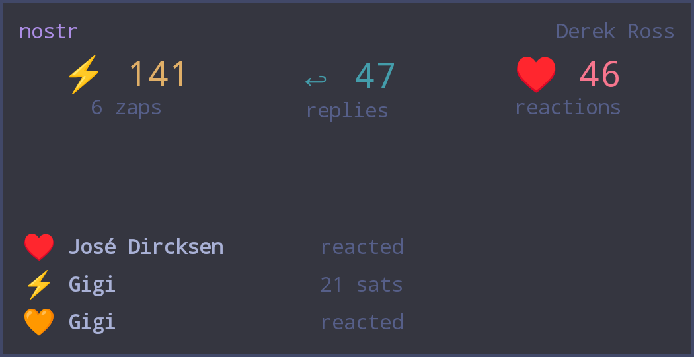

# nostr inbox

An [omalauncher](https://github.com/SimonSchubert/omalauncher) widget: zaps, replies, mentions, reactions and
reposts for any npub or NIP-05 address, from the last 7 days (up to 100 of each).

- Reads your inbox relays (NIP-65) and the senders' profiles.
- Tap the tile for the full list; tap an item to open it in your nostr app (`nostr:nevent1…`).
- Applies your NIP-51 mute list. Private mutes are decrypted by [Amber](https://github.com/greenart7c3/Amber)
  over NIP-46: tap **connect Amber** in the account section once.
- Optional notification for new zaps.

## Install

Copy `widget.owl` to `~/.config/omalauncher/widgets/`, or install it from the widget store.
Needs `websocat`, `jq` and `curl` (the tile offers to install them). Amber support, `nostr:` links and
signature checks need [nak](https://github.com/fiatjaf/nak); without it, links open on njump.me.

## Notes

- Your relay list, profile and mute list are signature-checked (with nak). Zaps, replies and reactions are not:
  a relay could show fake ones.
- Files: `~/.cache/nostr-inbox` (relay list, mute list, decrypted private mutes) and, if you have private mutes and nak,
  `~/.config/nostr-inbox` (a client key for Amber and the connection). All readable only by you.

## Develop

The fetch script is `src/inbox.sh`: `bash src/inbox.sh <npub|nprofile|hex|name@domain>` prints the inbox as JSON.
`./build.sh` embeds it into `widget.owl`.
